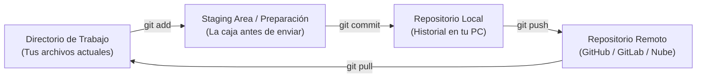
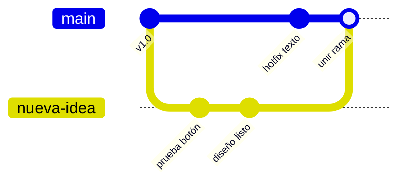
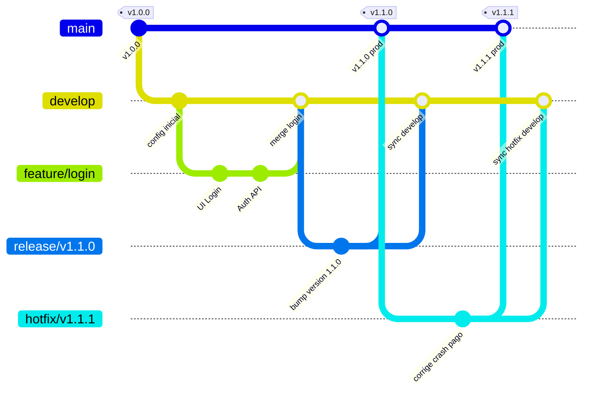

# 🚀 Guía Práctica y Visual de Git & Git Flow

¡Bienvenido! Esta guía está diseñada para que entiendas **Git** y **Git Flow** desde cero, sin rodeos ni tecnicismos confusos, utilizando explicaciones visuales, analogías sencillas y comandos reales listos para usar en el día a día.

---

## 📑 Tabla de Contenidos
1. [¿Qué es Git y por qué lo usamos?](#1-qué-es-git-y-por-qué-lo-usamos)
2. [Las 3 Zonas de Git (+1 Remota)](#2-las-3-zonas-de-git-1-remota)
3. [Comandos Esenciales del Día a Día](#3-comandos-esenciales-del-día-a-día)
4. [Ramas (Branches) y Resolución de Conflictos](#4-ramas-branches-y-resolución-de-conflictos)
5. [Git Flow: Metodología Profesional](#5-git-flow-metodología-profesional)
6. [Casos Prácticos Paso a Paso](#6-casos-prácticos-paso-a-paso)
7. [Buenas Prácticas & Chuleta Rápida (Cheat Sheet)](#7-buenas-prácticas--chuleta-rápida-cheat-sheet)

---

## 1. ¿Qué es Git y por qué lo usamos?

### 🎮 La analogía del videojuego
Imagina que estás jugando una partida difícil:
- Sin Git: Si tomas una mala decisión o pierdes la partida, tendrías que volver a empezar desde cero o crear copias como `proyecto_final.zip`, `proyecto_final_FINAL.zip`, `proyecto_ahora_si_definitivo.zip`.
- **Con Git**: Creas **Checkpoints** (puntos de guardado llamados *commits*). Si algo se rompe hoy, puedes volver al estado exacto de hace 2 horas, ayer o el mes pasado con un solo comando.

### 🌐 Git vs. GitHub / GitLab
> [!NOTE]
> - **Git**: Es el programa local en tu computadora que lleva el registro de los cambios. No necesita internet para funcionar.
> - **GitHub / GitLab / Bitbucket**: Son plataformas en la nube donde almacenas y compartes tus repositorios para trabajar en equipo.

---

## 2. Las 3 Zonas de Git (+1 Remota)

Git organiza tu trabajo en diferentes "estaciones" antes de que los cambios queden guardados definitivamente:



1. **Working Directory (Directorio de Trabajo)**: La carpeta donde estás editando archivos con tu editor (Android Studio, VS Code, etc.).
2. **Staging Area (Área de Preparación / Index)**: La "caja" donde seleccionas qué archivos específicos quieres empaquetar para guardar.
3. **Local Repository (Repositorio Local)**: El historial definitivo guardado en tu máquina (`.git`).
4. **Remote Repository (Repositorio Remoto)**: La copia en la nube disponible para tu equipo.

---

## 3. Comandos Esenciales del Día a Día

### ⚙️ Configuración Inicial (Solo la primera vez)
```bash
# Define tu identidad para los commits
git config --global user.name "Tu Nombre"
git config --global user.email "tu-email@ejemplo.com"
```

### 📁 Iniciar o Clonar un Proyecto
```bash
# Iniciar un repositorio nuevo en la carpeta actual
git init

# O clonar un repositorio existente desde GitHub
git clone https://github.com/usuario/mi-repositorio.git
```

### 🔍 Revisar el Estado
```bash
# Ver qué archivos se modificaron o están sin seguimiento
git status

# Ver el historial de commits en una sola línea por cada uno
git log --oneline --graph
```

### 💾 Guardar Cambios
```bash
# 1. Pasa un archivo a la zona de preparación (Staging)
git add nombre-archivo.kt

# O pasa TODOS los archivos modificados
git add .

# 2. Crea el punto de guardado (Commit) con un mensaje claro
git commit -m "feat: agrega pantalla de login"
```

### ☁️ Sincronizar con la Nube
```bash
# Descargar y combinar los últimos cambios remotos a tu rama actual
git pull origin develop

# Subir tus commits al repositorio remoto
git push origin develop
```

### 📦 El "Cajón de Sastre" (`git stash`)
¿Necesitas cambiar de rama urgente pero tienes cambios a medias que aún no quieres commitear?
```bash
# Guarda temporalmente tus cambios en un cajón secreto
git stash

# Cuando vuelvas y quieras recuperar tus cambios:
git stash pop
```

---

## 4. Ramas (Branches) y Resolución de Conflictos

### ¿Qué es una Rama?
Una rama es una línea de tiempo alterna. Te permite programar una nueva función sin arriesgar el código que ya funciona.



### Comandos de Ramas
```bash
# Listar ramas locales
git branch

# Crear y moverte a una nueva rama
git switch -c mi-nueva-rama
# (Equivalente al comando tradicional: git checkout -b mi-nueva-rama)

# Volver a una rama existente (por ejemplo, develop)
git switch develop
# (O: git checkout develop)

# Unir los cambios de otra rama en tu rama actual
git merge mi-nueva-rama
```

### 💥 ¿Cómo resolver un Conflicto sin pánico?
Un conflicto ocurre cuando dos personas modificaron la **misma línea del mismo archivo** y Git no sabe cuál versión conservar.

1. Al hacer `git merge`, Git te avisará: `CONFLICT (content): Merge conflict in ...`
2. Abre el archivo en conflicto. Verás marcas como estas:
   ```kotlin
   <<<<<<< HEAD (Tu código actual)
   val primaryColor = Color.Blue
   =======
   val primaryColor = Color.Green
   >>>>>>> mi-nueva-rama (El código entrante)
   ```
3. **Decide con qué código quedarte**: borra las líneas `<<<<<<<`, `=======` y `>>>>>>>`, dejando el código final deseado.
4. Guarda el archivo y completa el merge:
   ```bash
   git add archivo_resuelto.kt
   git commit -m "fix: resuelve conflicto de colores"
   ```

---

## 5. Git Flow: Metodología Profesional

**Git Flow** es una convención de nombres y flujo de trabajo para equipos que define qué ramas usar y cuándo fusionarlas.

### 🌳 Las 5 Ramas de Git Flow

| Tipo de Rama | Nombre habitual | ¿De dónde nace? | ¿A dónde se fusiona? | Propósito |
| :--- | :--- | :--- | :--- | :--- |
| **Permanente** | `master` / `main` | Inicio del repo | *(Nadie la borra)* | Código 100% estable en producción. |
| **Permanente** | `develop` | `master` | *(Nadie la borra)* | Base del desarrollo diario de la próxima versión. |
| **Temporal** | `feature/*` | `develop` | `develop` | Desarrollar una nueva funcionalidad aislada. |
| **Temporal** | `release/*` | `develop` | `master` y `develop` | Preparar, probar y congelar una versión para entrega. |
| **Temporal** | `hotfix/*` | `master` | `master` y `develop` | Arreglar un bug crítico urgente en producción. |

### 📊 Diagrama Visual de Git Flow



---

## 6. Casos Prácticos Paso a Paso

### 🛠️ Caso A: Crear una nueva funcionalidad (`feature`)
> **Meta**: Vas a crear la pantalla de perfil de usuario.

```bash
# 1. Asegúrate de estar en develop y actualizado
git switch develop
git pull origin develop

# 2. Crea tu rama feature
git switch -c feature/pantalla-perfil

# 3. Trabaja y haz commits de tu avance
git add .
git commit -m "feat: agrega formulario de perfil"

# 4. Cuando esté 100% lista y probada, vuelve a develop
git switch develop
git pull origin develop

# 5. Fusiona tu feature en develop
git merge feature/pantalla-perfil

# 6. Sube los cambios y elimina la rama local (opcional)
git push origin develop
git branch -d feature/pantalla-perfil
```

---

### 📦 Caso B: Preparar un lanzamiento oficial (`release`)
> **Meta**: El desarrollo de la versión `v1.0.0` está completo. Solo falta probar y desplegar.

```bash
# 1. Nace desde develop
git switch develop
git pull origin develop
git switch -c release/v1.0.0

# 2. Aquí SOLO se corrigen detalles menores, versiones de build o traducciones
git commit -am "chore: actualiza versión a 1.0.0"

# 3. Se fusiona en master (producción) y se etiqueta
git switch master
git pull origin master
git merge release/v1.0.0
git tag -a v1.0.0 -m "Versión 1.0.0 lista para producción"
git push origin master --tags

# 4. Se devuelve a develop para que conserve los ajustes hechos
git switch develop
git merge release/v1.0.0
git push origin develop

# 5. Se elimina la rama de release ya cerrada
git branch -d release/v1.0.0
```

---

### 🚨 Caso C: Reparar un bug crítico urgente en producción (`hotfix`)
> **Meta**: La app en producción se cierra al presionar un botón. No puedes esperar al siguiente release; debes arreglarlo de inmediato.

```bash
# 1. Nace DIRECTO desde master
git switch master
git pull origin master
git switch -c hotfix/v1.0.1-crash-inicio

# 2. Se repara el error
git commit -am "fix: soluciona NullPointerException al iniciar"

# 3. Se fusiona en master y se sube de versión
git switch master
git merge hotfix/v1.0.1-crash-inicio
git tag -a v1.0.1 -m "Hotfix crítico crash de inicio"
git push origin master --tags

# 4. IMPORTANTE: También se debe sincronizar con develop para no arrastrar el error
git switch develop
git merge hotfix/v1.0.1-crash-inicio
git push origin develop

# 5. Se elimina la rama del hotfix
git branch -d hotfix/v1.0.1-crash-inicio
```

---

## 7. Buenas Prácticas & Chuleta Rápida (Cheat Sheet)

### ✍️ Convención de Mensajes de Commit (Conventional Commits)
Usa prefijos claros para que cualquier persona entienda el historial de un vistazo:
- `feat:` Una nueva característica (ej: `feat: agrega autenticación biométrica`).
- `fix:` Corrección de un error o bug (ej: `fix: corrige validación de correo`).
- `docs:` Cambios solo en documentación (ej: `docs: actualiza README`).
- `style:` Formato, espacios, punto y coma (sin cambio de lógica).
- `refactor:` Refactorización de código sin añadir funciones ni corregir bugs.
- `chore:` Tareas rutinarias, dependencias o configuración de build (`chore: actualiza gradle`).

### 📌 Tabla Resumen de Comandos

| Necesidad | Comando |
| :--- | :--- |
| Saber en qué rama estoy y qué cambió | `git status` |
| Ver historial visual condensado | `git log --oneline --graph --all` |
| Crear y pasar a nueva rama | `git switch -c <nombre-rama>` |
| Cambiar a una rama existente | `git switch <nombre-rama>` |
| Traer lo último del servidor | `git pull origin <rama>` |
| Subir mis cambios | `git push origin <rama>` |
| Guardar cambios temporalmente | `git stash` |
| Recuperar cambios guardados | `git stash pop` |
| Deshacer cambios no guardados en un archivo | `git restore <archivo>` |
| Ver diferencias antes de commitear | `git diff` |

---

> [!TIP]
> **Regla de Oro en Equipos:** Nunca hagas commits directamente en `master` o `main`. Todo cambio viaja a través de ramas `feature/` o `hotfix/` aprobadas mediante *Pull Requests* / *Merge Requests*.
